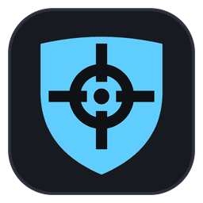

<div align="center">



# RustOverlay

**See your team's health, weapons, inventory and ammo at a glance.**<br>
No injection, no memory reading, no packet sniffing.

[](https://github.com/RustOverlay/rustoverlay-agent/releases/latest)
[](https://github.com/RustOverlay/rustoverlay-agent/releases)
[](LICENSE)

[**Download for Windows**](https://github.com/RustOverlay/rustoverlay-agent/releases/latest/download/RustOverlay-win-Setup.exe)

</div>

<!-- TODO: screenshots — team panel in-game, inspector open, Settings tab (docs/screenshots/) -->

## Features

- **Team panel.** Every online teammate's health, held item, rounds loaded and carried, syringes and
  barricades, in a transparent panel over the game.
- **Inventory inspector.** Hold `Left Alt` to unfold a teammate's full inventory — clothing,
  backpack, main grid and belt. Tap `C` to move to the next teammate.
- **Recognises skins.** Skinned items are matched using the game's own icons.
- **Stays out of the way.** Drawn only while Rust is in front, so it never sits over a browser or a
  screen share.
- **Updates itself.** New versions download in the background and apply when you close the app,
  never mid-session.

## Getting started

1. **Install.** Run [`RustOverlay-win-Setup.exe`](https://github.com/RustOverlay/rustoverlay-agent/releases/latest).
   It installs per-user and needs no administrator rights.
2. **Sign in.** The app opens a browser window to finish signing in.
3. **Form a team.** Create one, or enter a teammate's join code.
4. **Play.** Launch Rust in borderless or windowed mode. The overlay appears top-left.

For position sharing, add this bind in Rust's F1 console:

```
bind mouse1 "printpos;printeyes"
```

## Controls

| Key | Action |
|---|---|
| `F4` | show or hide the overlay |
| `Left Alt` (hold) | open the selected teammate's inventory |
| `C` (while holding) | next teammate |

Rebind any of them, and adjust size and position, in the **Settings** tab.

## Privacy and safety

RustOverlay never touches the game process. It reads the log file Rust writes on its own and the
screen while Rust is in front, and shares only your own data, only with your team. It holds no Steam
password and no Rust+ token.

The source is public so you can check that claim: [docs/privacy.md](docs/privacy.md) lists every file
it reads, and [`proto/`](proto/) defines every byte it sends.

## FAQ

**Windows SmartScreen warns me about the installer.**
It is not code-signed yet. Every release is built by GitHub Actions from this repository, and you can
[verify your download](docs/privacy.md#verifying-a-download) came from that build.

**The overlay doesn't appear.**
Exclusive fullscreen can't be drawn over. Set Rust to borderless and restart it — the app warns you
if this is the cause. If `-nolog` is in your Steam launch options, remove it; the app also tells you
about this one.

**Some counts are blank or dimmed.**
Blank means the item couldn't be identified confidently, so it is left out rather than guessed.
Dimmed counts come from a teammate's main inventory, which is only readable while they have it open.
See [docs/configuration.md](docs/configuration.md#reading-the-overlay).

**How accurate is the barricade count?**
Not yet measured. When unsure it shows nothing rather than a wrong number.

## Documentation

- [Configuration](docs/configuration.md) — settings file, environment variables, logs, how keys are read
- [Privacy and safety](docs/privacy.md) — everything the app reads and sends
- [Development](docs/development.md) — building from source, tests, calibration tools

## Licence

GPL-3.0, see [LICENSE](LICENSE). Bundles **Roboto Condensed Bold** (Apache-2.0,
[licence](crates/ro-capture/assets/RobotoCondensed-Bold.LICENSE.txt)), the typeface Rust draws its
HUD counts in. Rust's item icons and definitions are Facepunch's and are not bundled; they are read
from your own install.
